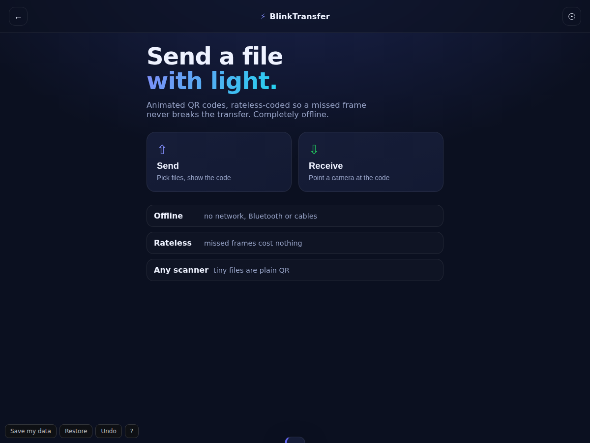

<div align="center">


# BlinkTransfer

<!-- shot:start -->



<!-- shot:end -->

**Send a file with light. No internet, no Bluetooth, no cables.**

Animated QR codes, **rateless-coded** so a missed frame never breaks the
transfer — the receiver only needs *enough* frames, not every one.

[](LICENSE)
[](COMMERCIAL.md)
[](https://github.com/drsamonline/BLINKTRANSFER/commits)
[](https://github.com/drsamonline/BLINKTRANSFER/stargazers)
[](https://github.com/drsamonline/BLINKTRANSFER/releases)
[](https://github.com/drsamonline/BLINKTRANSFER)
[](https://drsamonline.github.io/BLINKTRANSFER/play/)

**[Live demo](https://drsamonline.github.io/BLINKTRANSFER/play/)** &nbsp;·&nbsp;
**[Landing page](https://drsamonline.github.io/BLINKTRANSFER/)** &nbsp;·&nbsp;
**[All projects](https://drsamonline.github.io/)**

**Download:** [Windows (.exe)](https://github.com/drsamonline/BLINKTRANSFER/releases/latest/download/BLINKTRANSFER-portable.exe) &nbsp;·&nbsp; [Android (.apk)](https://github.com/drsamonline/BLINKTRANSFER/releases/latest/download/BLINKTRANSFER.apk)

</div>

---

BlinkTransfer moves files between two devices using **only a screen and a
camera**. One device shows an animated QR code; the other points its camera at
it. Nothing leaves the room — there is no server, no network and no pairing.

It is the **universal** member of the optical-transfer family: monochrome QR
only, standards-based, and deliberately dependency-light, so it works on the
cheapest phones and in the worst light.

## Why it is different

- **Rateless (fountain) coding.** Frames are LT-encoded symbols, not an ordered
  list. Miss one, or twenty, and the transfer still finishes — you just need
  about *k* good frames out of the loop. This is the feature the previous version
  promised and did not ship.
- **Any-scanner compatibility mode.** A small text file can be sent as a single
  plain QR that *any* third-party scanner can read — no app needed on the other
  side.
- **Truly offline.** Fully installable PWA; after first load it never touches the
  network.
- **Light on dependencies.** Two small, well-known libraries (`qrcode-generator`
  to draw, `jsQR` to read) and nothing else at runtime.

## How it works

```
files ─▶ gzip ─▶ split into k blocks ─▶ LT fountain symbols ─▶ QR frames (loop)
                                                                    │
  files ◀─ gunzip ◀─ reassemble ◀─ LT belief-propagation decode ◀─ jsQR ◀ camera
```

Each QR carries a 22-byte self-describing header plus one fountain symbol, so the
receiver can lock on to **any** frame — there is no header QR to catch first. A
header CRC-16 drops mis-read frames; the QR's own Reed-Solomon handles bit
errors; a CRC-32 on the whole payload confirms the finished file.

## Quick start

```bash
git clone https://github.com/drsamonline/BLINKTRANSFER.git
cd BLINKTRANSFER
npm install
npm run dev      # http://localhost:3000
npm test         # run the test suite
npm run build    # production bundle into docs/play/
```

Open the dev URL on both devices (or install the PWA). On one, **Send** and pick
files; on the other, **Receive** and point the camera.

## Performance

Throughput is roughly `frame bytes × frame rate`. Defaults: ~1.4 KB per frame at
12 fps ≈ 17 KB/s, and larger files loop.

| What | Note |
|------|------|
| Per frame | ~1.4 KB (balanced), ~0.8 KB (robust), ~1.8 KB (dense) |
| Frame rate | 2–24 fps, your choice |
| Limits | 20 MB total per transfer |
| Overhead | ~5–15% extra frames for the fountain decoder |

Bigger files work, but for anything over a few MB a network would be faster —
this is for when there is no network, or when you would rather there were not.

## Compatibility mode

Tick **Compatibility mode** to send one small text file (≤ 1.2 KB) as a single
plain QR. Any phone camera app will read it — useful for links, addresses, Wi-Fi
passwords and quick notes, with no second device running BlinkTransfer.

## Browser support

Chrome 80+, Edge 80+, Firefox 114+, Safari 16+.

Requires `getUserMedia` (camera), `CompressionStream` (gzip) and — for the sender
— the Wake Lock API (optional). `jsQR` and `qrcode-generator` are bundled, so
nothing is fetched at runtime.

## Project layout

```
src/
  index.html  styles.css  main.js  sw.js
  lib/
    fountain.js   LT fountain codes (encoder + belief-propagation decoder)
    frame.js      frame header, presets, CRC
    codec.js      multi-file container + gzip
    qr.js         QR encode (qrcode-generator) / decode (jsQR)
    utils.js      CRC-16/32, PRNG, helpers
public/           manifest + icons
tests/            node --test suite (fountain, frame, codec, optical loopback)
tools/            build.mjs, dev.mjs, serve.js
docs/             landing page + built demo (GitHub Pages)
```

## Testing

```bash
npm test
```

The suite includes a full **optical loopback**: files → gzip → fountain frames →
rendered QR pixels → jsQR → fountain decode → files, with binary data. No browser
required.

## Licence

BlinkTransfer is **free for personal, academic, hobby and non-profit use** under
the [PolyForm Noncommercial License 1.0.0](LICENSE).

**Commercial use needs a paid licence** — see [COMMERCIAL.md](COMMERCIAL.md) for
what counts as commercial and how to get one (by email invoice).

Third-party components and their licences are listed in [NOTICE](NOTICE).

> Note: earlier versions were published under the PolyForm Noncommercial licence. That grant stands
> for copies already distributed; this and future versions use the dual model
> above.

## Credits

Built by **Dr Sohil Momin** ([@drsamonline](https://github.com/drsamonline)).

QR rendering by [qrcode-generator](https://github.com/kazuhikoarase/qrcode-generator)
(MIT); QR decoding by [jsQR](https://github.com/cozmo/jsQR) (Apache-2.0).
